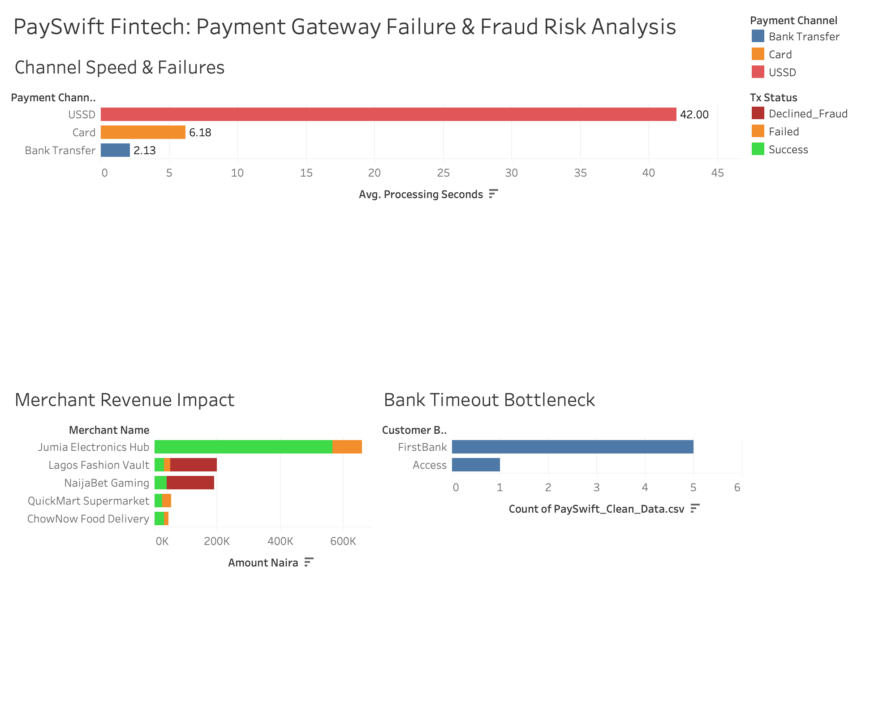

# 💳 PaySwift Fintech: Payment Gateway Failure & Fraud Risk Analysis
**Tools Used:** MySQL (`CASE WHEN` Conditional Aggregation, `INNER JOIN`, `HAVING` Fraud Rules) | Tableau (Executive Risk Dashboard)

## 📌 Executive Summary
PaySwift processes payments across **Card, Bank Transfer, and USSD** for enterprise and SME merchants in Nigeria. Following merchant complaints regarding failed transactions and suspected card-testing fraud, I analyzed gateway transaction logs (`Payment_Logs`) and merchant profiles (`Merchants`) to pinpoint infrastructure bottlenecks and flag fraudulent customer IDs.

---

## 📊 Payment Gateway & Fraud Risk Dashboard (Tableau)

---

## 🔍 Key Technical & Business Findings (via MySQL)

### 1. Payment Channel Bottleneck (`CASE WHEN` Analysis)
- **USSD is failing at an 83.3% rate (5 out of 6 transactions failed)** with an average processing latency of **42.00 seconds**.
- **Bank Transfers (OPay, GTBank, Zenith)** achieved a **100% success rate (0 failures)** with an ultra-fast average speed of **2.13 seconds**.
- **Card payments** averaged **6.18 seconds**, with failures driven primarily by insufficient funds and fraud blocks rather than network timeouts.

### 2. Bank Network Timeout Culprit
- Isolating `Error_Code = 'Bank_Timeout'` revealed that **FirstBank accounted for 83.3% of all network timeouts (5 out of 6 timeouts)**, averaging **49.60 seconds** per transaction before failing.
- **OPay (1.40s)**, **GTBank (3.20s)**, and **Zenith Bank (4.00s)** experienced **zero network timeouts**.

### 3. Automated Fraud Detection (`HAVING COUNT > 1` Rule)
- Wrote a SQL fraud-detection rule grouping `Declined_Fraud` (`Suspected_Card_Testing`) logs by `Customer_ID` where repeat attempts exceeded 1 (`HAVING COUNT(Tx_ID) > 1`).
- Flagged two high-risk actors conducting rapid card-testing attacks within 60-second windows:
  - **`Customer_ID: C999`** — **3 consecutive declined attempts** targeting *NaijaBet Gaming* (₦150,000 total attempted).
  - **`Customer_ID: C888`** — **2 consecutive declined attempts** targeting *Lagos Fashion Vault* (₦150,000 total attempted).

---

## 💡 Strategic Engineering & Risk Recommendations
1. **Dynamic Smart Routing for USSD / FirstBank:** Automatically display a checkout prompt recommending **Bank Transfer** whenever FirstBank USSD latency exceeds 15 seconds, recovering stuck merchant revenue.
2. **Velocity-Based IP & Card Blocking:** Implement an automated velocity rule blocking any `Customer_ID` or card bin for 24 hours after **2 consecutive `Declined_Fraud` attempts within 5 minutes**, protecting high-risk merchants (*NaijaBet Gaming* and *Lagos Fashion Vault*).
